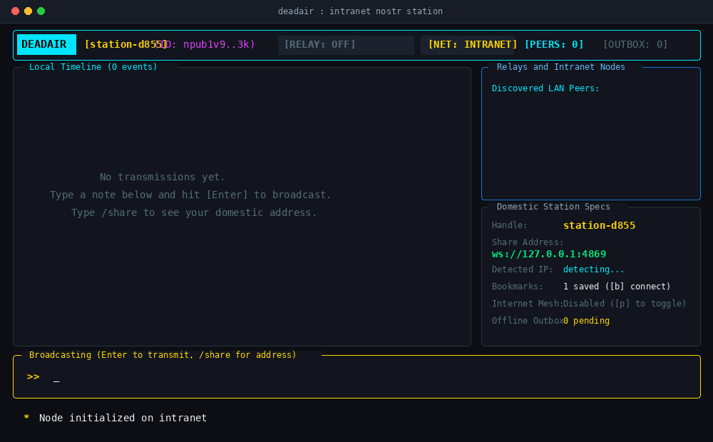
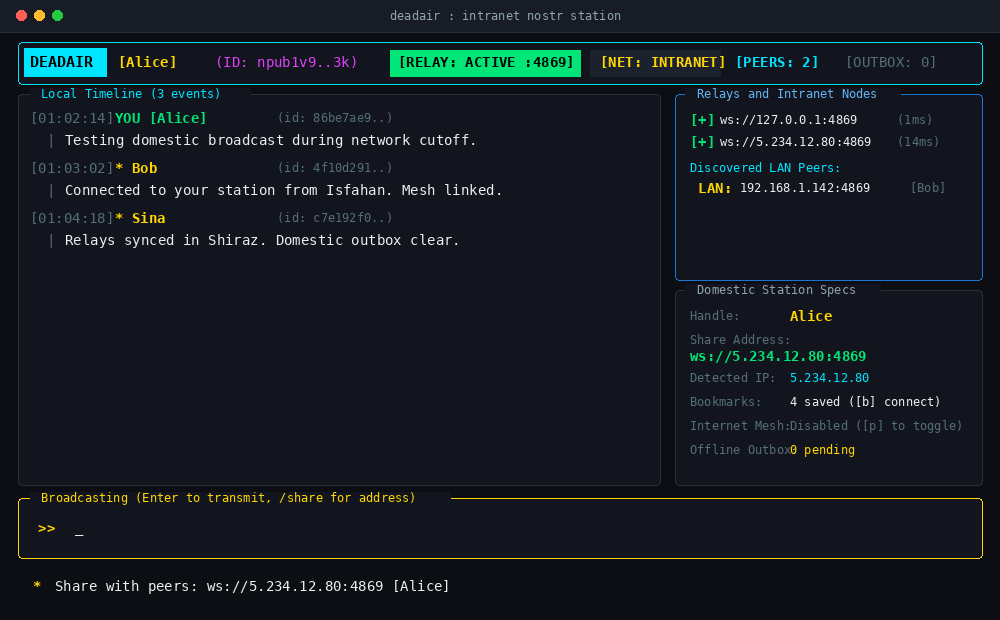

```
   ____  _________    ____  ___    ________ 
  / __ \/ ____/   |  / __ \/   |  /  _/ __ \
 / / / / __/ / /| | / / / / /| |  / // /_/ /
/ /_/ / /___/ ___ |/ /_/ / ___ |_/ // _, _/ 
/_____/_____/_/  |_/_____/_/  |_/___/_/ |_|  
```

> ایستگاه آفلاین پروتکل نوستر در محیط ترمینال، مهندسی‌شده برای شرایط قطعی اینترنت، شبکه‌های مش و بقا در بستر اینترانت ملی.

[English](README.md) | [فارسی](README.fa.md)

---

### صورت مسئله

هنگامی که اینترنت بین‌الملل قطع می‌شود، ابزارهایی مانند تلگرام، واتس‌اپ، دیسکورد و سیگنال به طور کامل از کار می‌افتند زیرا سرورهای آنها در خارج از کشور مستقر هستند.

با این وجود، مسیریابی داده‌ها میان ارائه‌دهندگان اینترنت داخلی و شهرهای مختلف کشور معمولا برقرار باقی می‌ماند.

پروژه DEADAIR دقیقا برای چنین شرایطی ساخته شده است. این ابزار بدون وابستگی به هیچ سرور خارجی، بدون نیاز به دامنه و بدون هزینه‌های زیرساختی مستقیما در ترمینال شما اجرا می‌شود. هر لپ‌تاپ یا سیستمی که DEADAIR را اجرا کند، می‌تواند به عنوان یک ایستگاه ارتباطی برای دوستان و همکاران عمل کند بدون اینکه حتی یک بسته داده به خارج از مرزهای کشور ارسال شود.

---

### نمای کلی محیط کاربری





---

### سناریوی کاربردی در دنیای واقعی

1. **اجرای ایستگاه**: دستور `deadair` را در ترمینال اجرا کنید. کلیدهای رمزنگاری شما به صورت کاملا آفلاین در اولین اجرا تولید می‌شوند.
2. **تنظیم نام کاربری**: با دستور `/name Alice` نام دلخواه خود را تعیین کنید.
3. **روشن کردن رله**: کلید `[r]` را فشار دهید تا سرور وب‌سوکت داخلی روی پورت `4869` آغاز به کار کند.
4. **اشتراک‌گذاری آدرس**: کلید `[s]` را فشار دهید یا دستور `/share` را تایپ کنید. آدرس اتصال داخلی خود را (مثلا `ws://5.x.x.x:4869 [Alice]`) از طریق پیامک یا بسترهای داخلی برای دوستانتان بفرستید.
5. **ارتباط میان شهرها**: دوستان شما دستور `/bookmark add ws://5.x.x.x:4869 Alice` را وارد می‌کنند. اکنون همه بدون وابستگی به اینترنت بین‌الملل عضو یک شبکه پیام‌رسانی مستقل و پایدار هستند.

---

### قابلیت‌های فنی

* **استقلال کامل از سرورهای مرکزی**: بدون نیاز به ثبت‌نام، شماره موبایل یا کلمه عبور. هویت شما یک جفت‌کلید امن بر پایه الگوریتم secp256k1 است که در مسیر `~/.config/deadair/identity.json` نگهداری می‌شود.
* **تشخیص خودکار IP شبکه داخلی**: شناسایی آدرس شبکه بدون نیاز به درگیری با تنظیمات دستی شبکه.
* **مدیریت پایدار نشانک‌های رله‌ها**: ذخیره گره‌های مورد اعتماد در فایل `~/.config/deadair/domestic_relays.json` و اتصال مجدد به همه آنها با فشردن کلید `[b]`.
* **کشف خودکار روی شبکه محلی**: در شبکه‌های وای‌فای یا LAN، ایستگاه‌ها از طریق پورت UDP 48690 بدون هیچ تنظیمی یکدیگر را پیدا می‌کنند.
* **صندوق پیام‌های آفلاین**: در صورت قطع کامل هر نوع ارتباط، پیام‌ها در مسیر `~/.config/deadair/outbox.json` صف‌بندی شده و به محض اتصال مجدد ارسال می‌شوند.
* **همگام‌سازی با اینترنت جهانی**: هر زمان که اینترنت بین‌الملل به طور موقت وصل شد، با کلید `[p]` رله‌های عمومی جهانی (`damus.io`, `nos.lol`, `primal.net`) را متصل کنید تا پیام‌ها میان دو شبکه رد و بدل شوند.

---

### روش‌های نصب

#### نصب سریع با یک دستور (لینوکس و مک)

```bash
curl -fsSL https://raw.githubusercontent.com/deltafsociety/dead-air/master/install.sh | bash
```

پس از اتمام نصب، برنامه در هر کجای ترمینال با دستور زیر در دسترس است:
```bash
deadair
```

#### دریافت فایل‌های اجرایی آماده
فایل‌های مستقل برای سیستم‌عامل‌ها در [صفحه انتشارها (Releases)](https://github.com/deltafsociety/dead-air/releases) موجود است:
* لینوکس (معماری x86_64)
* ویندوز (معماری x86_64)
* مک اواس اپل سیلیکون (معماری ARM64)
* مک اواس اینتل (معماری x86_64)

#### ساخت از روی سورس کد
```bash
cargo build --release
./target/release/deadair
```

---

### راهنمای دستورات و کلیدهای میانبر

#### دستورات ترمینال
* `/name <نام>`: تنظیم نام نمایشی ایستگاه.
* `/share`: نمایش رشته اتصال ایستگاه جهت اشتراک‌گذاری با دیگران.
* `/ip`: تشخیص مجدد آدرس IP داخلی.
* `/bookmark add <آدرس> [نام]`: ذخیره رله داخلی در فهرست نشانک‌ها و اتصال به آن.
* `/bookmark remove <شناسه>`: حذف یک رله از نشانک‌ها.
* `/bookmark connect`: اتصال مجدد به تمامی نشانک‌های داخلی.
* `/relay add <آدرس>`: اتصال به هر رله وب‌سوکت.
* `/relay public`: فعال یا غیرفعال کردن رله‌های اینترنت جهانی.
* `/help`: نمایش خلاصه دستورات.

#### کلیدهای میانبر
| کلید | عملکرد |
| :--- | :--- |
| `i` یا `Enter` | ورود به حالت نوشتن |
| `Enter` (در حالت نوشتن) | انتشار پیام یا اجرای دستور |
| `Esc` یا `Tab` | تغییر حالت میان نوشتن و ناوبری |
| `s` | نمایش آدرس داخلی جهت اشتراک‌گذاری |
| `b` | اتصال مجدد به تمام نشانک‌های داخلی |
| `r` یا `F2` | روشن یا خاموش کردن رله داخلی روی پورت 4869 |
| `p` | تغییر وضعیت اتصال به رله‌های اینترنت جهانی |
| `c` | پاک کردن خط زمانی صفحه نمایش |
| `q` یا `Ctrl+C` | خروج از برنامه |

---

### مجوز نرم‌افزار

این پروژه تحت مجوز نرم‌افزاری MIT منتشر شده است. ساخته‌شده برای حق حاکمیت دیجیتال و برقراری ارتباط پایدار.
