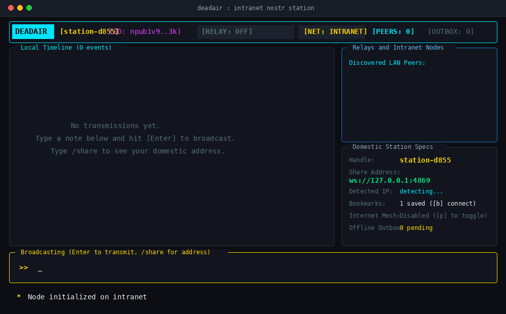
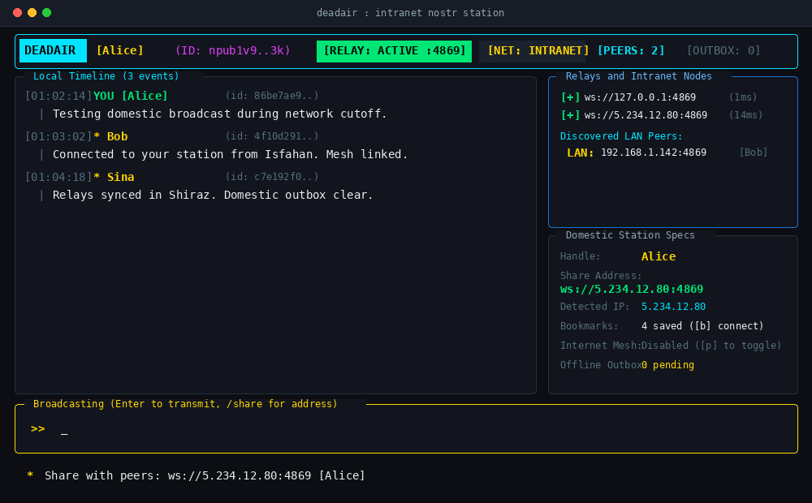

```
   ____  _________    ____  ___    ________ 
  / __ \/ ____/   |  / __ \/   |  /  _/ __ \
 / / / / __/ / /| | / / / / /| |  / // /_/ /
/ /_/ / /___/ ___ |/ /_/ / ___ |_/ // _, _/ 
/_____/_____/_/  |_/_____/_/  |_/___/_/ |_|  
```

> **DEADAIR** is a free, open-source chat and broadcast station built to keep people connected when the internet is shut down or censored. It works over local Wi-Fi, Ethernet cables, and domestic intranet connections without relying on foreign servers or central companies.

<p align="center">
  <a href="https://github.com/deltafsociety/dead-air"></a>
  <a href="https://t.me/LOW_SIGNAL73"></a>
  <a href="https://coindrop.to/delta"></a>
  <a href="docs/HOW_IT_WORKS.md"></a>
</p>

[English](README.md) | [فارسی](README.fa.md) | [Documentation / نحوه کارکرد](docs/HOW_IT_WORKS.md)

---

### Why DEADAIR?

During internet blackouts or censorship periods, services like Telegram, WhatsApp, Signal, and Discord stop working because their servers are hosted in Europe or North America.

However, **local connections still work**:
- Devices on the same Wi-Fi router or office LAN can still talk directly to each other.
- Domestic routing between local internet providers and cities often stays online even when the international gateway is shut.

**DEADAIR** lets you use that surviving local infrastructure. Any computer running DEADAIR can act as a local station or relay for your household, office, neighborhood, or contacts across the country—without sending any traffic outside.

---

### Screenshot & Demo





---

### How to Use It (In 4 Simple Steps)

1. **Start the app**: Run `deadair` in your terminal or launch `deadair-gui` from your application menu. Your cryptographic identity is generated on your machine on first launch.
2. **Choose a nickname**: Type `/name Alice`.
3. **Turn your computer into a local relay**: Press `[r]`. Your station is now listening on port `4869`.
4. **Connect with peers**:
   - **On the same Wi-Fi**: DEADAIR finds other devices automatically via local network beacons. No setup needed.
   - **Across cities**: Press `[s]` to copy your Safe Base64 Ticket (e.g. `deadair://...`) or domestic IP address and share it with friends via SMS or phone. They run `/bookmark add <ticket>` and you are connected.

---

### Key Features

* **No Accounts or Phone Numbers**: Uses standard Nostr cryptographic keys (`secp256k1`) stored locally in `~/.config/deadair/identity.json`.
* **Automatic Discovery (LAN & Mesh)**: Stations on the same local network find each other automatically over UDP port `48690`. Remote stations across cities discover each other via automatic relay presence gossip.
* **Multi-Tab Interface**:
  - `[1] Main Mesh`: Global broadcasts seen by all connected stations.
  - `[2] Direct Chat`: 1-on-1 private messaging via `/dm <user> <message>`.
  - `[3] Topic Groups`: Channel-scoped discussions via `/group <name>`.
* **Picture Sharing**: Attach and transmit images natively across the mesh via `/image <path>` (TUI) or `[+ PICTURE]` (GUI).
* **Safe Base64 Tickets**: Addresses can be encoded as `deadair://...` tickets for safe transfer over SMS. Receivers decode and connect with a single click or command.
* **One-Key Local Relay**: Press `[r]` to turn your PC into a relay for friends and family.
* **Offline Outbox**: Draft messages while offline; DEADAIR sends them automatically the moment a connection is restored.
* **Clean & Emoji-Free**: Cybernetic minimalist interface without emoji bloat or clutter.
* **TUI & Desktop GUI**: Run in your favorite terminal or as a native desktop window with a custom icon.

---

### Quick Installation & Uninstallation

The installer detects and installs any missing tools (Rust, build tools, Git) and compiles natively for your computer. It gives you the option to install the **Terminal TUI**, the **Desktop GUI**, **Both**, or completely **Uninstall**.

#### Linux and macOS
```bash
# Interactive installer (prompts for TUI / GUI / Both / Uninstall):
curl -fsSL https://raw.githubusercontent.com/deltafsociety/dead-air/master/install.sh | bash

# To uninstall DEADAIR completely:
curl -fsSL https://raw.githubusercontent.com/deltafsociety/dead-air/master/install.sh | bash -s -- --uninstall
```

#### Windows (PowerShell)
```powershell
# Interactive installer:
irm https://raw.githubusercontent.com/deltafsociety/dead-air/master/install.ps1 | iex

# To uninstall DEADAIR completely:
$env:DEADAIR_TARGET="uninstall"; irm https://raw.githubusercontent.com/deltafsociety/dead-air/master/install.ps1 | iex
```

Once installed:
* **Terminal TUI**: Run `deadair` in any terminal or command prompt.
* **Desktop GUI**: Open **DEADAIR** from your desktop application menu or Start Menu.

---

### Manual Compilation from Source

If you prefer building manually with Cargo:

```bash
# Clone the repository
git clone https://github.com/deltafsociety/dead-air.git
cd dead-air

# 1. Build and run Terminal TUI
cargo build --release -p deadair
./target/release/deadair

# 2. Build and run Desktop GUI (Tauri v2)
cargo build --release -p deadair-gui
./target/release/deadair-gui
```

---

### Commands & Keyboard Shortcuts

#### Commands
* `/tab [1|2|3]`: Switch between Main Mesh, Direct Chat, and Groups.
* `/dm <user> <text>`: Send a direct message in the private chat tab.
* `/group <name>`: Switch or join a group channel (e.g., `/group alerts`).
* `/image <file> [caption]`: Transmit a picture attachment across the mesh.
* `/share`: Show your domestic address and Base64 Safe Ticket.
* `/bookmark add <ticket|url>`: Connect to and bookmark a station or safe ticket.
* `/decode <ticket>`: Decode and inspect a Base64 safe connection ticket.
* `/like`: Like (+1 reaction) the selected message.
* `/reply <text>`: Reply directly to the selected message in a thread.
* `/name <nick>`: Set your display nickname.
* `/ip`: Re-detect your domestic IP address.
* `/clear`: Clear the message view.
* `/help`: Show command help.

#### Keyboard Shortcuts
| Key | Action |
| :--- | :--- |
| `Tab` | Cycle through Main, Direct, and Groups tabs |
| `1` / `2` / `3` | Directly select Main, Direct, or Groups tab |
| `j` / `Down` | Move down through messages |
| `k` / `Up` | Move up through messages |
| `g` / `Home` | Jump back to live streaming view |
| `G` / `End` | Jump to oldest message in memory |
| `l` / `L` | Like (+1) the selected message |
| `r` | Reply to selected message |
| `R` / `F2` | Turn local relay on / off (`0.0.0.0:4869`) |
| `i` / `Enter` | Start typing a message |
| `Enter` (while typing) | Send message or run command |
| `Esc` | Cancel typing / return to navigation |
| `s` | Display your shareable address &amp; Safe Ticket |
| `b` | Reconnect to all saved bookmarks |
| `c` | Clear message feed |
| `q` / `Ctrl+C` | Quit DEADAIR |

---

### Detailed Architecture & Documentation

Want to understand the protocols, packet formats, and network topology?
Read the full guide: **[docs/HOW_IT_WORKS.md](docs/HOW_IT_WORKS.md)**.

---

### Support & Community

* **GitHub**: [github.com/deltafsociety/dead-air](https://github.com/deltafsociety/dead-air)
* **Donate**: [coindrop.to/delta](https://coindrop.to/delta)
* **Telegram**: [t.me/LOW_SIGNAL73](https://t.me/LOW_SIGNAL73)

---

### License

Open source under the [MIT License](LICENSE). Built for sovereign and resilient communication.
