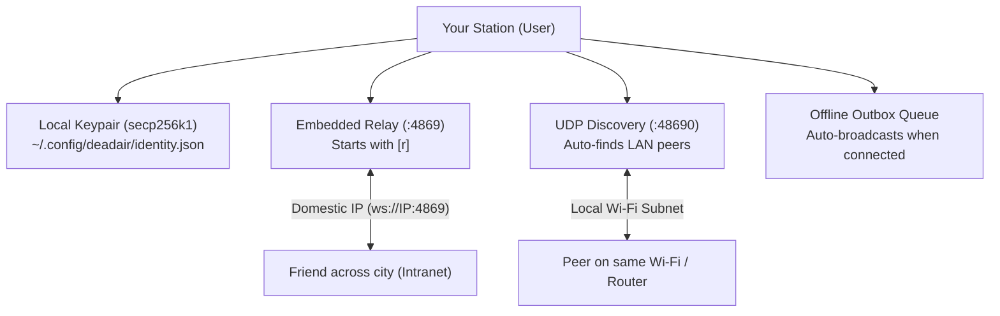

# How DEADAIR Works // Complete Guide & Architecture

[English](HOW_IT_WORKS.md) | [فارسی](#راهنمای-فارسی-نحوه-کارکرد-deadair)

---

## What is DEADAIR?

**DEADAIR** is an offline-first, peer-to-peer communication station built for situations where the international internet is completely shut down, blocked, or censored.

When governments shut off access to the global internet, foreign servers powering apps like Telegram, Signal, WhatsApp, and Discord go dark. However, the physical local network (your Wi-Fi, Ethernet, and domestic ISP routing between cities) usually remains alive. 

DEADAIR turns any ordinary laptop, PC, or home server into a private communication relay using the decentralized Nostr protocol. You can message people on your same Wi-Fi router, across a local mesh, or across domestic city IP addresses—without ever sending a single packet through foreign servers.

---

## Quick Navigation
* [Core Concepts in Plain English](#core-concepts-in-plain-english)
* [Step-by-Step: How It Works](#step-by-step-how-it-works)
* [Architecture Diagram](#architecture-diagram)
* [How to Use (Real-World Scenarios)](#how-to-use-real-world-scenarios)
* [Data & Storage Layout](#data--storage-layout)
* [Security & Privacy](#security--privacy)
* [Links & Community](#links--community)
* [راهنمای فارسی (نحوه کارکرد DEADAIR)](#راهنمای-فارسی-نحوه-کارکرد-deadair)

---

## Core Concepts in Plain English

1. **No Accounts, No Phone Numbers, No Servers Needed to Buy:**
   When you first run DEADAIR, it creates a unique cryptographic identity (a public/private keypair) right on your computer. You never sign up with a phone number, email, or password.

2. **Your Computer IS a Relay:**
   Usually, chat apps require a central company server. In DEADAIR, pressing `[r]` in the app starts an embedded WebSocket relay on your own machine. Your friends can connect directly to your IP.

3. **Automatic Local Wi-Fi Discovery (UDP Beacons):**
   If you and a friend or family member are on the same Wi-Fi or office network, you don't even need to type an IP address. DEADAIR sends a quiet local broadcast beacon every 10 seconds. Neighbor stations find each other automatically.

4. **Offline Outbox (Store & Forward):**
   If you type a message while you are walking or completely disconnected, DEADAIR saves it to an encrypted local queue on disk. The moment your station connects to a peer or relay, it sends your queued messages automatically.

5. **Exclusively for DEADAIR (No Foreign Relays):**
   Public Nostr relays are flooded with global chatter and spam that require high-speed internet and waste limited local bandwidth. DEADAIR only processes and stores messages meant for DEADAIR stations, keeping your local mesh clean, fast, and private.

---

## Step-by-Step: How It Works



### 1. Identity Generation
When you first start DEADAIR:
- It creates a standard `secp256k1` Nostr keypair.
- Your public key is saved to `~/.config/deadair/identity.json`.
- Every message you write is cryptographically signed by your private key, so no one can impersonate you or forge your messages.

### 2. Network Discovery
- **Local LAN / Wi-Fi**: DEADAIR listens on UDP port `48690`. When another station appears on your local network, both stations greet each other and sync messages immediately.
- **Across Cities (Domestic Intranet)**: DEADAIR automatically detects your local or routable domestic IP address. You press `[s]` to copy your share address (e.g. `ws://5.x.x.x:4869 [YourName]`). You send this string to your friends via SMS or phone call. They add it with `/bookmark add ws://5.x.x.x:4869 YourName`.

### 3. Relay Hosting & Synchronization
- Any station can be a client, a relay, or both.
- When station A writes a message, it sends it to its own relay and all connected peer relays.
- Connected peers receive the message in real time, verify its cryptographic signature, and display it in their feed.

---

## How to Use (Real-World Scenarios)

### Scenario A: Same Building or Wi-Fi Network
1. Both people open DEADAIR (`deadair` in terminal, or `deadair-gui` from the application menu).
2. Set your nicknames: `/name Bob` and `/name Alice`.
3. That's it! Within seconds, the local UDP beacon will discover both stations and show `[LAN PEER DISCOVERED]`. You can now chat in real-time without internet access.

### Scenario B: Across Different Cities During an Internet Shutdown
1. Start DEADAIR on your laptop.
2. Turn on your relay by pressing `[r]`.
3. Press `[s]` (or type `/share`) to see your domestic address:
   ```text
   Domestic Address: ws://151.x.x.x:4869 [Alice]
   ```
4. Send that address to your friend in another city via SMS or phone call.
5. Your friend runs:
   ```text
   /bookmark add ws://151.x.x.x:4869 Alice
   ```
6. You are now connected directly through the domestic network!

---

## Data & Storage Layout

DEADAIR stores all configuration locally in your user profile:
- **Linux & macOS**: `~/.config/deadair/`
- **Windows**: `%LOCALAPPDATA%\deadair\` (or `%USERPROFILE%\.config\deadair\`)

Files:
- `identity.json`: Your cryptographic private and public key.
- `domestic_relays.json`: Your saved list of domestic peer stations and bookmarked nodes.
- `outbox.json`: Messages drafted while offline, waiting for a connection.

---

## Security & Privacy

- **End-to-End Cryptography**: All transmissions are signed with your private key. Nobody can edit or tamper with your messages.
- **No Telemetry**: DEADAIR never phones home, uses no tracking analytics, and makes zero connections to third-party services.
- **Sovereign**: The code is 100% open source under the MIT license and builds from source on your own machine.

---

## Links & Community

* **Source Code & GitHub**: [https://github.com/deltafsociety/dead-air](https://github.com/deltafsociety/dead-air)
* **Donate & Support**: [https://coindrop.to/delta](https://coindrop.to/delta)
* **Telegram Channel**: [https://t.me/LOW_SIGNAL73](https://t.me/LOW_SIGNAL73)

---

<br>

# راهنمای فارسی نحوه کارکرد DEADAIR

## برنامه DEADAIR چیست؟

**DEADAIR** یک ایستگاه ارتباطی همتابه‌همتا (P2P) و آفلاین است که مخصوص شرایط **قطع کامل اینترنت بین‌الملل** و خاموشی‌های سراسری شبکه طراحی شده است.

هنگامی که اینترنت جهانی مسدود می‌شود، سرور برنامه‌هایی مانند تلگرام، واتس‌اپ و سیگنال از دسترس خارج می‌شوند زیرا این سرورها در خارج از کشور قرار دارند. با این حال، کابل‌ها و ارتباطات شبکه داخلی (اینترانت، وای‌فای محلی و فیبرهای نوری بین اپراتورها و شهرهای مختلف) فعال هستند.

برنامه DEADAIR هر رایانه یا لپ‌تاپ معمولی را به یک رله پیام‌رسان مستقل تبدیل می‌کند. شما می‌توانید بدون نیاز به هیچ سرور خارجی، با اطرافیان در شبکه وای‌فای یکسان یا با دوستانتان در شهرهای دیگر از طریق شبکه داخلی پیام رد و بدل کنید.

---

## ویژگی‌های اصلی به زبان ساده

۱. **بدون نیاز به ثبت نام و شماره تلفن**:
   در اولین اجرا، یک جفت کلید امنیتی رمزنگاری به صورت کاملاً آفلاین روی دستگاه شما تولید می‌شود. هویت شما فقط متعلق به خود شماست.

۲. **رایانه شما خودش یک سرور است**:
   با فشردن کلید `[r]`، یک سرور رله وب‌سوکت روی سیستم شما فعال می‌شود. دیگران می‌توانند مستقیماً به آدرس IP شما متصل شوند.

۳. **پیدا کردن خودکار افراد در یک وای‌فای (UDP Beacon)**:
   اگر با همکاران، خانواده یا همسایه‌ها به یک مودم وای‌فای مشترک وصل هستید، نیازی به وارد کردن هیچ آدرسی ندارید. دستگاه‌ها هر چند ثانیه سیگنال محلی ارسال کرده و یکدیگر را خودکار پیدا می‌کنند.

۴. **صندوق ارسال آفلاین (Outbox)**:
   اگر هنگام راه رفتن یا قطعی موقت شبکه پیامی بنویسید، پیام در صف ذخیره می‌شود و به محض برقراری اتصال با اولین دوست یا ایستگاه، خودکار ارسال خواهد شد.

۵. **محیط امن و اختصاصی DEADAIR**:
   ترافیک اسپم و رله‌های عمومی اینترنت که باعث مصرف ترافیک و کندی می‌شوند مسدود شده‌اند؛ برنامه فقط پیام‌های معتبر شبکه DEADAIR را مبادله می‌کند.

---

## سناریوهای استفاده در زندگی واقعی

### سناریوی ۱: اعضای یک خانه یا ساختمان متصل به یک مودم
۱. هر دو نفر برنامه را اجرا می‌کنند (`deadair` در خط فرمان یا `deadair-gui` از منوی برنامه‌ها).
۲. نام خود را تنظیم می‌کنند: `name Ali/` و `name Sara/`.
۳. برنامه به طور خودکار از طریق وای‌فای ارتباط را برقرار کرده و پیام‌ها فوراً منتقل می‌شوند.

### سناریوی ۲: ارتباط بین دو شهر هنگام قطعی اینترنت
۱. شما برنامه را باز کرده و با زدن کلید `[r]` رله را روشن می‌کنید.
۲. با زدن کلید `[s]` آدرس خود را مشاهده و یادداشت می‌کنید:
   ```text
   ws://5.x.x.x:4869 [Ali]
   ```
۳. این آدرس را با پیامک برای دوست خود در شهر دیگر ارسال می‌کنید.
۴. دوست شما در برنامه خود دستور زیر را وارد می‌کند:
   ```text
   /bookmark add ws://5.x.x.x:4869 Ali
   ```
۵. ارتباط مستقیم اینترانت برقرار است و می‌توانید بدون اینترنت جهانی چت کنید!

---

## حمایت و راه‌های ارتباطی

* **گیت‌هاب پروژه**: [https://github.com/deltafsociety/dead-air](https://github.com/deltafsociety/dead-air)
* **حمایت مالی (Donate)**: [https://coindrop.to/delta](https://coindrop.to/delta)
* **کانال تلگرام**: [https://t.me/LOW_SIGNAL73](https://t.me/LOW_SIGNAL73)
