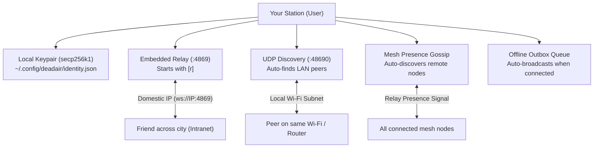

# How DEADAIR Works // Complete Architecture & User Guide

[English](HOW_IT_WORKS.md) | [فارسی](#راهنمای-فارسی-نحوه-کارکرد-deadair)

---

## What is DEADAIR?

**DEADAIR** is an offline-first, peer-to-peer communication station built for situations where the international internet is completely shut down, blocked, or censored.

When governments shut off access to the global internet, foreign servers powering apps like Telegram, Signal, WhatsApp, and Discord go dark. However, the physical local network (your Wi-Fi, Ethernet, and domestic ISP routing between cities) usually remains alive. 

DEADAIR turns any ordinary laptop, PC, or home server into a private communication relay using the decentralized Nostr protocol. You can message people on your same Wi-Fi router, across a local mesh, or across domestic city IP addresses—without ever sending a single packet through foreign servers.

---

## Quick Navigation
* [Core Concepts in Plain English](#core-concepts-in-plain-english)
* [Step-by-Step: How It Works](#step-by-step-how-it-works)
* [Architecture Diagram](#architecture-diagram)
* [Multi-Tab Communication: Main, Direct & Groups](#multi-tab-communication-main-direct--groups)
* [Picture Transmission](#picture-transmission)
* [Safe Base64 Connection Tickets](#safe-base64-connection-tickets)
* [Global & Intranet Peer Discovery](#global--intranet-peer-discovery)
* [How to Install and Uninstall](#how-to-install-and-uninstall)
* [Security & Privacy](#security--privacy)
* [Links & Community](#links--community)
* [راهنمای فارسی (نحوه کارکرد DEADAIR)](#راهنمای-فارسی-نحوه-کارکرد-deadair)

---

## Core Concepts in Plain English

1. **No Accounts, No Phone Numbers, No Servers Needed to Buy:**
   When you first run DEADAIR, it creates a unique cryptographic identity (a public/private keypair) right on your computer. You never sign up with a phone number, email, or password.

2. **Your Computer IS a Relay:**
   Usually, chat apps require a central company server. In DEADAIR, pressing `[r]` in the app starts an embedded WebSocket relay on your own machine. Your friends can connect directly to your IP.

3. **Automatic Local & Mesh Discovery:**
   - **Local Wi-Fi (UDP Beacon)**: If you and a friend or family member are on the same Wi-Fi or office network, DEADAIR sends quiet local broadcast beacons every 10 seconds. Stations find each other automatically.
   - **Across Cities (Mesh Presence Gossip)**: When nodes connect to any domestic relay, DEADAIR periodically broadcasts a presence announcement. Connected stations automatically learn about each other and interconnect into an intranet mesh.

4. **Multi-Tab Communication (Main, Direct & Groups):**
   - **[1] Main Mesh**: Global public broadcasts seen by everyone in your domestic network.
   - **[2] Direct Chat**: Private 1-on-1 conversations (`/dm <user> <msg>`).
   - **[3] Groups**: Topic channels (`/group <name>`) like `#general`, `#alerts`, and `#tech`.

5. **Picture Sharing Support:**
   Users can attach and send pictures (`/image <path>` in TUI or `[+ PICTURE]` in GUI) with inline data encoding and thumbnail rendering.

6. **Safe Base64 Address Tickets:**
   Instead of exposing raw IP addresses in plain text, DEADAIR encodes station addresses into safe Base64 tickets (`deadair://...`). Pasting a ticket automatically decrypts and connects immediately.

7. **Offline Outbox (Store & Forward):**
   If you type a message while disconnected, DEADAIR saves it to an encrypted local queue on disk. The moment your station connects to a peer or relay, it sends your queued messages automatically.

---

## Step-by-Step: How It Works



### 1. Identity Generation
When you first start DEADAIR:
- It creates a standard `secp256k1` Nostr keypair.
- Your public key is saved to `~/.config/deadair/identity.json`.
- Every message you write is cryptographically signed by your private key, so no one can impersonate you or forge your messages.

### 2. Network Discovery
- **Local LAN / Wi-Fi**: DEADAIR listens on UDP port `48690`. When another station appears on your local network, both stations greet each other and sync messages immediately.
- **Across Cities (Domestic Intranet)**: DEADAIR automatically detects your routable domestic IP address. You press `[s]` to copy your share address or Safe Ticket (`deadair://...`). Send this string to your contacts via SMS or call. They add it with `/bookmark add <ticket>`.
- **Mesh Presence Gossip**: When connected to any domestic relay, stations periodically broadcast their presence signal tagged `["client", "deadair"]`, `["type", "presence"]`. All nodes on that relay automatically discover each other's addresses and peer together.

### 3. Relay Hosting & Synchronization
- Any station can be a client, a relay, or both.
- When station A writes a message, it sends it to its own relay and all connected peer relays.
- Connected peers receive the message in real time, verify its cryptographic signature, and display it in their feed.

---

## Multi-Tab Communication: Main, Direct & Groups

DEADAIR features three organized tabs in both the Terminal TUI and Desktop GUI:

1. **Main Mesh Feed (`[1]`)**:
   Public transmissions distributed to all stations on the mesh. Ideal for broadcasts, sitreps, and general communications.
2. **Direct Chat (`[2]`)**:
   Targeted 1-on-1 private messaging. Use `/dm <user> <msg>` or select a peer from the discovered list.
3. **Topic Groups (`[3]`)**:
   Channel-scoped conversations tagged with a channel name (e.g., `#alerts`, `#mesh`, `#general`). Switch or join channels with `/group <name>`.

Cycle tabs in the TUI using `Tab` or keys `1`, `2`, `3`.

---

## Picture Transmission

You can share pictures across the domestic mesh even without internet access:
- **Terminal TUI**: Run `/image /path/to/picture.png [caption]`. The image is read, converted to a compact base64 data URI, and transmitted. Receivers see a clean card tag `[ATTACHED PICTURE: caption (size)]` without cluttering the screen.
- **Desktop GUI**: Click `[+ PICTURE]`, select an image from your disk, and transmit. The image renders as an inline thumbnail with click-to-view.

---

## Safe Base64 Connection Tickets

For security and privacy when transmitting addresses over SMS or insecure local chats, DEADAIR supports Base64 ticket encoding:
- Run `/share` in TUI or click **SAFE TICKET** in GUI.
- You will receive a code like:
  ```text
  deadair://eyJ3cyI6IndzOi8vNS4xLjIuMzo0ODY5IiwibmFtZSI6IkFsaWNlIn0=
  ```
- Send this code to a friend.
- Your friend runs `/bookmark add deadair://...` or pastes it into the GUI connect box.
- DEADAIR decodes the ticket on the fly, validates the address, adds the bookmark, and connects immediately.

---

## How to Install and Uninstall

### Install One-Liners (Interactive Menu):
Select `[1]` for Terminal TUI, `[2]` for Desktop GUI, `[3]` for Both, or `[4]` to Uninstall.

**Linux & macOS:**
```bash
curl -fsSL https://raw.githubusercontent.com/deltafsociety/dead-air/master/install.sh | bash
```

**Windows (PowerShell):**
```powershell
irm https://raw.githubusercontent.com/deltafsociety/dead-air/master/install.ps1 | iex
```

### Complete Uninstallation:
To remove DEADAIR binaries, desktop entries, shortcuts, and application icons from your system:

**Linux & macOS:**
```bash
curl -fsSL https://raw.githubusercontent.com/deltafsociety/dead-air/master/install.sh | bash -s -- --uninstall
```

**Windows (PowerShell):**
```powershell
$env:DEADAIR_TARGET="uninstall"; irm https://raw.githubusercontent.com/deltafsociety/dead-air/master/install.ps1 | iex
```

---

## Security & Privacy

- **End-to-End Signatures**: Every note, reaction, and presence announcement is signed with your private key.
- **No Foreign Relays / Spam Filtering**: Public internet relays and foreign spam are strictly rejected. Only authentic DEADAIR traffic travels through the mesh.
- **No Telemetry**: DEADAIR makes zero analytics calls, collects no telemetry, and connects only to relays you or your local mesh peers configure.
- **Open Source**: Licensed under the MIT License.

---

## Links & Community

* **GitHub Repository**: [https://github.com/deltafsociety/dead-air](https://github.com/deltafsociety/dead-air)
* **Donate**: [https://coindrop.to/delta](https://coindrop.to/delta)
* **Telegram Channel**: [https://t.me/LOW_SIGNAL73](https://t.me/LOW_SIGNAL73)

---

<br>

# راهنمای فارسی نحوه کارکرد DEADAIR

## برنامه DEADAIR چیست؟

**DEADAIR** یک ایستگاه ارتباطی همتابه‌همتا (P2P) و آفلاین است که مخصوص شرایط **قطع کامل اینترنت بین‌الملل** و خاموشی‌های سراسری شبکه طراحی شده است.

هنگامی که اینترنت جهانی مسدود می‌شود، سرور برنامه‌هایی مانند تلگرام، واتس‌اپ و سیگنال از دسترس خارج می‌شوند زیرا این سرورها در خارج از کشور قرار دارند. با این حال، کابل‌ها و ارتباطات شبکه داخلی (اینترانت، وای‌فای محلی و فیبرهای نوری بین اپراتورها و شهرهای مختلف) فعال هستند.

برنامه DEADAIR هر رایانه یا لپ‌تاپ معمولی را به یک رله پیام‌رسان مستقل تبدیل می‌کند. شما می‌توانید بدون نیاز به هیچ سرور خارجی، با اطرافیان در شبکه وای‌فای یکسان یا با دوستانتان در شهرهای دیگر از طریق شبکه داخلی پیام رد و بدل کنید.

---

## قابلیت‌های کلیدی جدید به زبان ساده

۱. **کشف خودکار همتایان در سطح اینترانت**:
   علاوه بر وای‌فای محلی، ایستگاه‌ها با انتشار سیگنال حضور روی رله‌های داخلی به صورت خودکار یکدیگر را پیدا کرده و متصل می‌شوند.

۲. **تفکیک گفتگوها در ۳ تب مجزا**:
   - **فید عمومی (Main Mesh)**: مخابره عمومی پیام‌ها به تمام اعضای شبکه.
   - **پیام‌های مستقیم (Direct Chat)**: گفتگوی خصوصی دونفره با دستور `/dm`.
   - **کانال‌های گروهی (Groups)**: چت در کانال‌های موضوعی با دستور `/group`.

۳. **امکان ارسال تصاویر**:
   ارسال عکس از طریق دستور `/image` در نسخه ترمینال یا کلید `[+ PICTURE]` در نسخه گرافیکی دسکتاپ.

۴. **بلیط امن کدگذاری‌شده با Base64**:
   آدرس ایستگاه شما به صورت یک بلیط امن (مانند `deadair://...`) کدگذاری می‌شود تا در پیامک یا چت‌های محلی بدون افشای مستقیم IP به راحتی منتقل شده و توسط برنامه مقابل خودکار رمزگشایی و متصل شود.

۵. **قابلیت حذف کامل (Uninstall)**:
   اسکریپت نصب امکان حذف تمام فایل‌های اجرایی، آیکون‌ها و میانبرها را به طور کامل فراهم می‌کند.

---

## سناریوهای استفاده در زندگی واقعی

### سناریوی ۱: اعضای یک ساختمان متصل به یک مودم
۱. هر دو نفر برنامه را اجرا می‌کنند (`deadair` در خط فرمان یا `deadair-gui` از منوی برنامه‌ها).
۲. نام خود را تنظیم می‌کنند: `/name Ali` و `/name Sara`.
۳. برنامه به طور خودکار از طریق وای‌فای ارتباط را برقرار کرده و پیام‌ها فوراً منتقل می‌شوند.

### سناریوی ۲: ارتباط بین دو شهر هنگام قطعی اینترنت
۱. شما برنامه را باز کرده و با زدن کلید `[r]` رله را روشن می‌کنید.
۲. با زدن کلید `[s]` بلیط امن Base64 خود را مشاهده و یادداشت می‌کنید:
   ```text
   deadair://eyJ3cyI6IndzOi8vNS4xLjIuMzo0ODY5IiwibmFtZSI6IkFsaWNlIn0=
   ```
۳. این کد را با پیامک برای دوست خود در شهر دیگر ارسال می‌کنید.
۴. دوست شما در برنامه خود دستور زیر را وارد می‌کند:
   ```text
   /bookmark add deadair://...
   ```
۵. ارتباط مستقیم برقرار است و می‌توانید بدون اینترنت جهانی چت کنید!

---

## راه‌های ارتباطی و حمایت مالی

* **گیت‌هاب**: [https://github.com/deltafsociety/dead-air](https://github.com/deltafsociety/dead-air)
* **حمایت مالی (Donate)**: [https://coindrop.to/delta](https://coindrop.to/delta)
* **کانال تلگرام**: [https://t.me/LOW_SIGNAL73](https://t.me/LOW_SIGNAL73)
